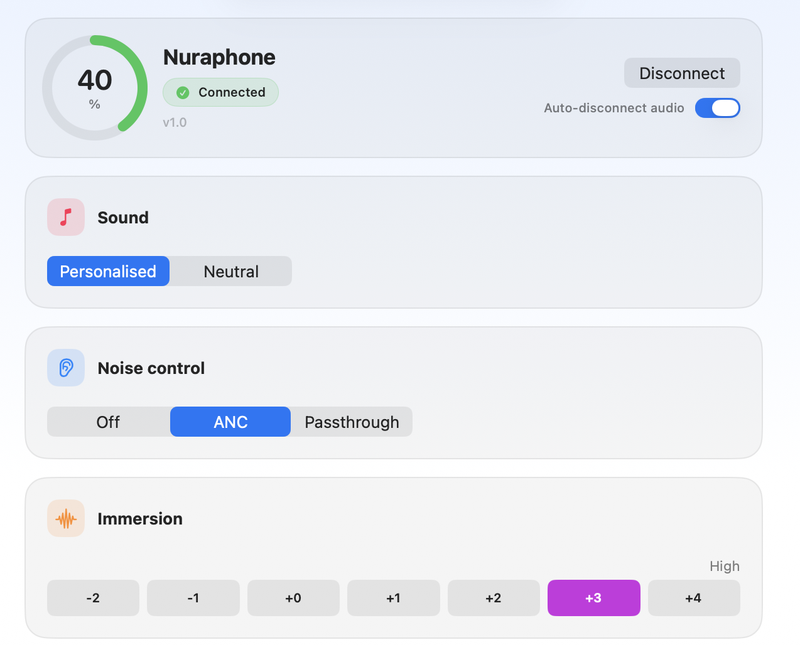
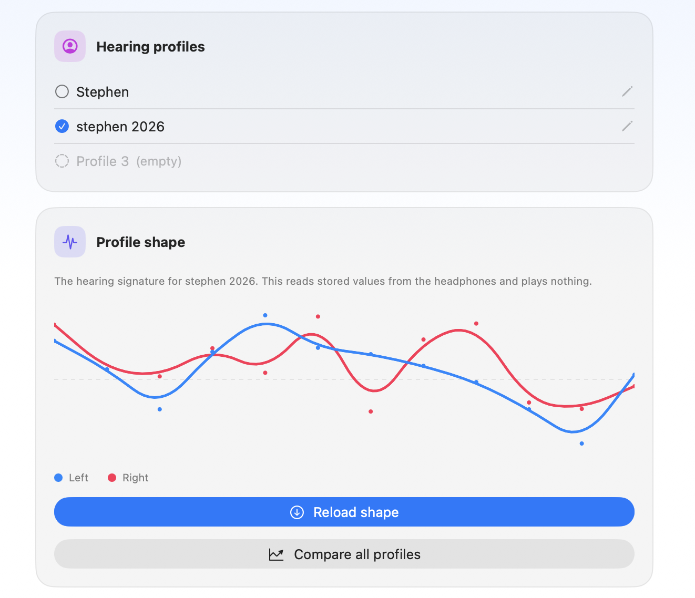
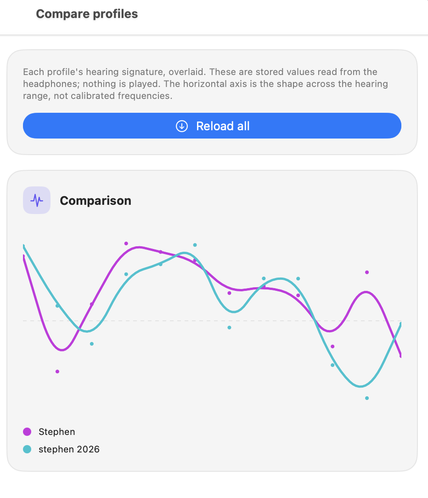
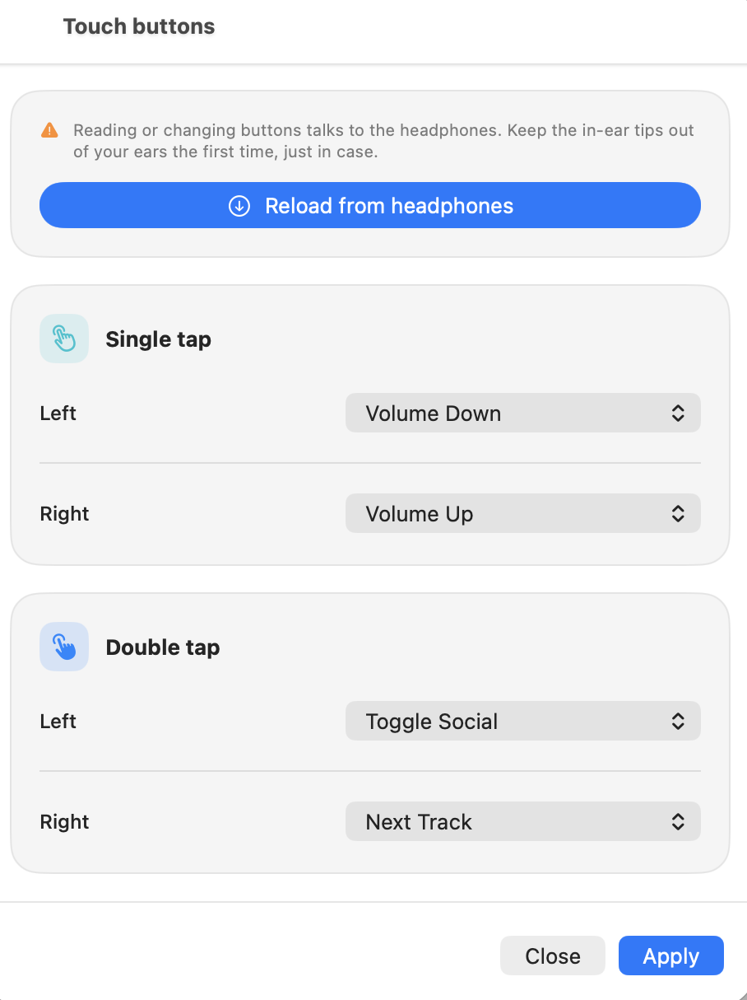
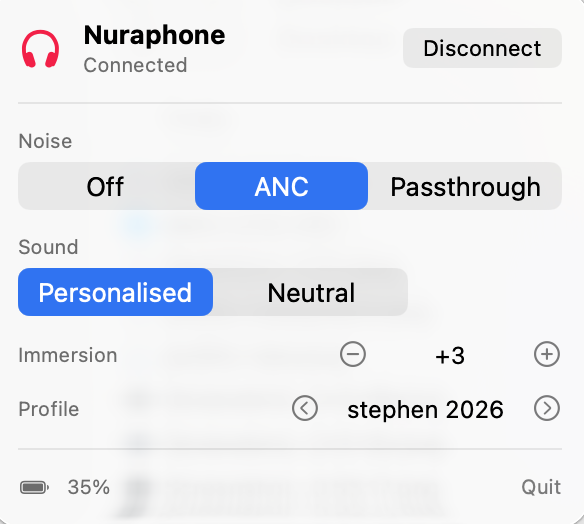

# OpenNura

OpenNura is an unofficial control app for the original over-ear
Nuraphone. It talks to the headphones directly, without the discontinued Nura
app, and can recover the device key tied to your Nura account.

- ANC, Social Mode, neutral/personalised sound and immersion controls
- profile switching, names and profile comparisons
- touch-button remapping
- global shortcuts and a menu bar controller
- device-key recovery

NuraLoop, NuraTrue Pro and Denon PerL Pro are also supported, however not much testing has been done yet. I will do this when I have time.

<p align="center">
  
</p>

## Caution

This project uses an undocumented, reverse-engineered protocol. It is not made,
endorsed or supported by Nura.

Unexpected headphone output is possible when experimenting with hardware
controls. During initial setup, wear the Nuraphone with the in-ear tips outside
your ears. If you hear anything unusual, take it off and power it down.

The controls have not been tested against every firmware version. The developer's nuraphones are on 606. **There is no
warranty; use the software at your own risk.**

## Profiles and controls

### Hearing profiles

Read a profile's stored hearing signature or compare several profiles at once.

<p align="center">
  
  
</p>

### Touch controls

Single- and double-tap actions can be read from the headphones and remapped.

<p align="center">
  
</p>

### Menu bar

On macOS, the main controls are also available from a compact menu-bar popover.

<p align="center">
  
</p>

## What you need

- a Mac with Xcode
- an original Nuraphone paired
- an Apple development team for local code signing (a free personal team works)
- for key recovery, access to the Nura account that owns the headphones

Key recovery also depends on Nura's servers remaining online. Back up your key
once you have it.

## Build

1. Open `opennura.xcodeproj`.
2. Select the `opennura` target.
3. Under **Signing & Capabilities**, choose your development team.
4. Select **My Mac or your iOS Device** as the destination and run the app.
5. Allow Bluetooth access when the device asks.

For a signed and notarised build that can live in `/Applications`, see
[docs/BUILD-AND-NOTARIZE.md](docs/BUILD-AND-NOTARIZE.md).

## Connect

On iOS, OpenNura uses Bluetooth LE to connect to the headphones, on macOS this can cause issues with volume control not being recieved by the nuraphones and touch controls from the nuraphones not working on the Mac. Bluetooth LE does have faster pair time however as we do not need to disconnect the device first to connect to the control channel.

Connect the Nuraphone to the device normally before pressing **Connect** in
OpenNura. The app uses the active audio route to distinguish it from old or
unavailable Nura devices in your Bluetooth pairing history.

Opening the control channel while the audio link is active does not work
reliably on macOS. By default, OpenNura therefore:

1. identifies the active Nuraphone;
2. briefly disconnects its audio link;
3. opens the cached GAIA service over RFCOMM channel 1.

This affects only the Nuraphone, not your other Bluetooth devices. You can turn
off **Disconnect audio automatically** if you prefer to manage the audio link
yourself.

## Recover the device key

Each Nuraphone has a unique 16-byte AES key used to encrypt control commands.
OpenNura needs that key before it can change settings.

Denon PerL Pro does not support key recovery at the moment, it is a low priority item for me, as you can still grab it from the Keychain, and Denon is still releasing new products with the Denon Headphones app. You will just need to import the device serial and key manually.

If you do not already have it:

1. Connect the Nuraphone to the Mac.
2. Open the **Devices** tab.
3. Choose **Recover key from Nura**.
4. Sign in with your Nura account email and verification code.
5. Start recovery and leave the headphones powered on and worn while it runs.

OpenNura relays the provisioning exchange between the headphones and Nura's
backend, then saves the recovered key locally. Normal control is offline after
that.

The **Devices** tab can reveal and copy the key. Store a backup somewhere safe:
if Nura turns off the remaining backend, an existing key should still allow
local control, but a new one cannot be recovered.

## Limitations

- Only the original Nuraphone is supported at this time.
- Initial control-channel setup briefly interrupts Bluetooth audio.
- Key recovery depends on Nura's backend.
- Some controls from the official app are not implemented.
- Classic Bluetooth RFCOMM is available to this project on macOS, not iOS.

If connection or recovery stalls, start with
[docs/TROUBLESHOOTING.md](docs/TROUBLESHOOTING.md).

## Development

The Xcode project builds the app and its platform-specific Bluetooth code.
Protocol and parsing tests live in the Swift package:

```sh
swift test
```

Those tests do not exercise the UI or a real Bluetooth connection.

Implementation notes:

- [Architecture](docs/ARCHITECTURE.md)
- [Key recovery](docs/KEY-RECOVERY.md)
- [Roadmap](docs/ROADMAP.md)

## Credits and licence

The provisioning flow is based on reverse-engineering from Callum Carmicheal's
[Nura-Windows](https://github.com/CallumCarmicheal/Nura-Windows) project.
Detailed provenance is recorded in [ATTRIBUTION.md](ATTRIBUTION.md) and
[NOTICE](NOTICE).

OpenNura is distributed under the
[GNU General Public License v3](LICENSE). Code derived from Nura-Windows retains
its Apache 2.0 attribution; see [LICENSE-APACHE](LICENSE-APACHE).

“Nura” and “Nuraphone” are trademarks of their respective owners. OpenNura is
not affiliated with, endorsed by or sponsored by Nura or its successors. The
names are used only to identify the hardware with which the software
interoperates.
